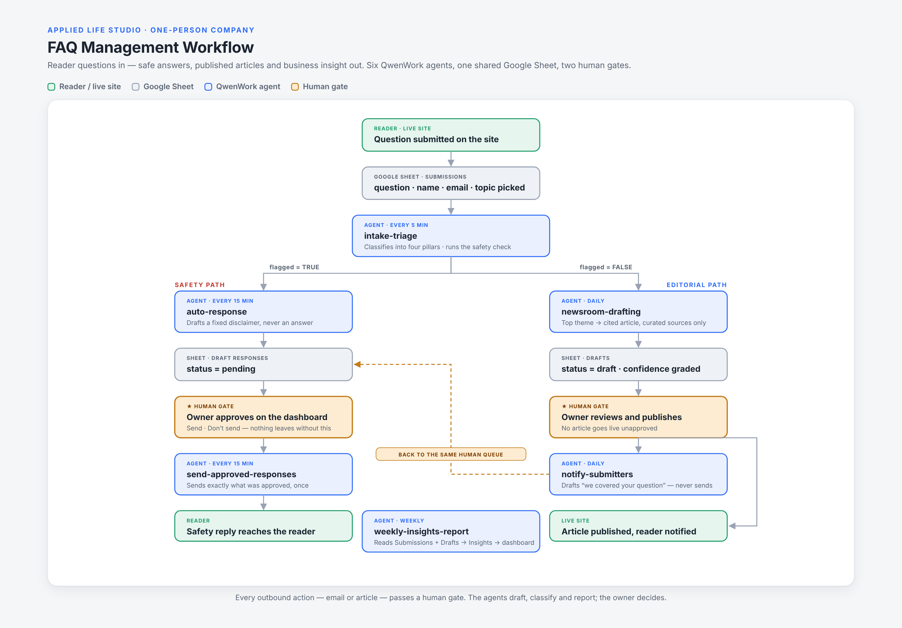

# FAQ Management Workflow

**An autonomous editorial-operations pipeline for a one-person health publication — built on QwenWork scheduled tasks, with a human approval gate in front of everything that reaches a reader.**

Submitted to the **QwenWork One-Person Company Hackathon — Track 01: Business Operations & Automation**.

The sample company is **Applied Life Studio**, a longevity and health site: <https://applied-life-studio.geo.hashmeta.tech>



> **This repository contains no live data and no credentials.** Every reference to a
> spreadsheet is a `YOUR_SPREADSHEET_ID` placeholder, and the dashboard's config is a
> template with empty values. You supply your own sheet — see
> [**Set up your own sheet**](#set-up-your-own-sheet) below. Nothing here will run
> until you do.

---

## The problem

A one-person publication in health and longevity has an inbox problem that doesn't scale.

Readers send questions faster than one person can answer them. Some of those questions are genuinely useful editorial signal — the same theme asked five different ways is next week's article. Others are the opposite of useful: they ask for a personal supplement dose, a medication-interaction ruling, or an interpretation of a blood panel. Those must never receive an answer from a content site, and a tired operator at 1 a.m. is exactly who answers them anyway.

Meanwhile the owner has no read on their own operation. Which topics are actually growing? What share of the inbox is clinical risk rather than curiosity? Are the questions readers ask the same ones the site is publishing about?

## The approach

Six scheduled QwenWork tasks turn that inbox into a weekly editorial operation. A single Google Sheet is the shared state between them — every task reads it, writes to it, and leaves an audit trail in it.

The design rule the whole pipeline is built around: **automation drafts, a human decides.** No email reaches a reader and no article reaches the site without an explicit approval. The agents do the triage, the research and the writing; the owner does the judgement calls, in seconds rather than hours.

---

## Pipeline

| # | Skill | Cadence | What it does |
|---|---|---|---|
| 1 | [`intake-triage`](skills/intake-triage/SKILL.md) | ~5 min | Classifies each new question into Longevity, Brain, Vision, Physical Health or Unclassified, and flags anything asking for personal dosage, medication-interaction or lab-result advice. |
| 2 | [`auto-response`](skills/auto-response/SKILL.md) | ~5–15 min | For every flagged row, **drafts** a safety disclaimer and referral into the approval queue. It does not send. |
| 3 | [`newsroom-drafting`](skills/newsroom-drafting/SKILL.md) | daily | Takes the week's strongest theme and drafts a cited, evidence-graded article from a fixed per-category list of trusted sources. Lands in `Drafts` as pending approval. |
| 4 | [`notify-submitters`](skills/notify-submitters/SKILL.md) | daily | Once an article is published, **drafts** a "your question was covered" email to everyone whose question fed it. Also queued, not sent. |
| 5 | [`send-approved-responses`](skills/send-approved-responses/SKILL.md) | ~5–15 min | The only task that sends anything. Picks up rows a human approved, sends them, marks them sent, and flips the matching flag back on `Submissions`. |
| 6 | [`weekly-insights-report`](skills/weekly-insights-report/SKILL.md) | weekly | Writes four business numbers to `Insights`: theme trend, safety-escalation rate, trust coverage of published articles, and submitter-vs-triage classification agreement. |

### Two design decisions worth calling out

**The visitor's category pick is a hint, not an authority.** The submission form lets readers choose their own category, because it's a better form experience. `intake-triage` ignores it as a decision and re-classifies independently — then the weekly report *measures the disagreement*. That gap (`classification_agreement`) is a real operating metric: it tells the owner whether readers and the site share a mental model of the subject matter, which is a content-strategy signal, not a bug.

**Nothing auto-publishes.** The pipeline drafts articles and stops. The owner publishes manually and marks the sheet. In a domain where a wrong confident sentence can hurt someone, the last mile stays human on purpose.

### Safety handling

Flagged questions never get a substantive answer. They get a fixed disclaimer and a referral to a qualified professional — drafted automatically, approved by a human, then sent. Articles carry an explicit `confidence` grade (well-supported / mixed evidence / contested) and cite their sources, and the drafting skill is instructed to state plainly which submissions it deliberately did not answer and why.

---

## The data store

One Google Sheet, four tabs, used as the pipeline's shared state and audit log. Full column reference: [`docs/sheet-schema.md`](docs/sheet-schema.md).

| Tab | Role |
|---|---|
| `Submissions` | Every incoming question + triage result + per-stage flags. Contains visitor names and emails — **never published**. |
| `Drafts` | Article drafts with sources, confidence grade, status and published URL. |
| `Draft Responses` | The approval queue. Outgoing emails waiting on a human verdict. |
| `Insights` | One row per week, four business metrics. |

Using a spreadsheet rather than a database is deliberate: the operator can inspect, correct or override any stage of the pipeline with no tooling, and every agent write is visible in the revision history.

---

## Ops dashboard

A dependency-free static page — plain HTML and vanilla JS, no build step, no backend — that reads the sheet's published CSV tabs and renders the week at a glance, published articles, category breakdowns, and the pending-approval queue with **Send** / **Don't send** buttons.

It is built to be privacy-safe by construction: the page never fetches the `Submissions` tab. The category chart is a pre-computed aggregate the operator supplies in config, so no visitor-level data reaches a viewer's browser.

Deeper detail on the CSV flow and the approval-endpoint contract: [`dashboard/README.md`](dashboard/README.md).

---

## Set up your own sheet

Allow about 15 minutes. Steps 1–3 are required; steps 4–6 are optional and each
unlocks one more part of the dashboard.

### 1. Create the spreadsheet and its four tabs

Create a new Google Sheet. Name it whatever you like — the skills resolve it by ID,
not by name. Then create four tabs named **exactly**:

```
Submissions      Drafts      Draft Responses      Insights
```

Paste one of these lines into row 1 of the matching tab (Google Sheets will split a
comma-separated paste across columns; if it doesn't, use **Data → Split text to
columns**). Column *order* doesn't matter — every skill reads by header name — but
the spelling does: all lower-case, underscores not spaces.

**`Submissions`**
```
timestamp,question,name,email,category,flagged,responded,drafted,safety_draft_created,notify_draft_created,category_submitted,notified
```

**`Drafts`**
```
date,category,title,article_body,sources_cited,confidence,status,published_url
```

**`Draft Responses`**
```
draft_id,type,recipient_email,subject,body,context,submission_ref,status,created_at
```

**`Insights`**
```
week_ending,theme_trend,safety_escalation_rate,trust_coverage,classification_agreement
```

Leave every tab empty below row 1. The pipeline fills them.

### 2. Find your spreadsheet ID

Open your sheet and look at the browser address bar. The ID is the long string
between `/d/` and `/edit`:

```
https://docs.google.com/spreadsheets/d/1AbCdEfGhIjKlMnOpQrStUvWxYz0123456789/edit
                                       └──────────── this is your ID ────────────┘
```

### 3. Put your ID into the six skills

Each `SKILL.md` has a **Shared data source** block near the top containing two
placeholders. Replace them in all six files:

| Placeholder | Replace with |
|---|---|
| `YOUR_SPREADSHEET_ID` | your ID from step 2 (appears twice per file — once as the ID, once inside the URL) |
| `<YOUR SHEET NAME>` | your sheet's title, for human readability only |

From the repository root:

```bash
# macOS / Linux
grep -rl YOUR_SPREADSHEET_ID skills/ | xargs sed -i '' 's/YOUR_SPREADSHEET_ID/1AbCdEfG…your-id/g'

# Linux (GNU sed)
grep -rl YOUR_SPREADSHEET_ID skills/ | xargs sed -i 's/YOUR_SPREADSHEET_ID/1AbCdEfG…your-id/g'
```

```powershell
# Windows PowerShell
Get-ChildItem skills -Recurse -Filter SKILL.md |
  ForEach-Object { (Get-Content $_.FullName -Raw) -replace 'YOUR_SPREADSHEET_ID','1AbCdEfG…your-id' |
  Set-Content $_.FullName -NoNewline }
```

Then confirm nothing was missed — this should print nothing:

```bash
grep -rn YOUR_SPREADSHEET_ID skills/
```

Now install the skills: drop each folder under `skills/` into your QwenWork skills
directory and register it as a scheduled task at the cadence in the pipeline table
above. Make sure the account running them has edit access to your sheet.

### 4. Feed the Submissions tab

Your intake form needs to append one row per question to `Submissions`. The simplest
route is a Google Form:

1. Create a form with these fields: **Your question** (long answer, required),
   **Name**, **Email**, and **Topic** — a multiple-choice with Longevity, Brain,
   Vision, Physical Health, Other.
2. In the form's **Responses** tab, click the Sheets icon and link it to **your
   existing spreadsheet**. Google creates a new tab for the responses.
3. Map its columns into `Submissions`. Either rename the generated tab's headers to
   match (`timestamp`, `question`, `name`, `email`, `category_submitted`) and use it
   as your `Submissions` tab, or keep both tabs and add a row-copy step.

Whatever form you use, it must write at least `timestamp`, `question`, `name`,
`email` and `category_submitted`. Leave the pipeline-owned columns (`category`,
`flagged`, and the `*_draft_created` / sent flags) empty — the skills own those, and
a form that writes to them will confuse the triage stage into skipping rows.

> **`category_submitted` is the reader's own pick and is never authoritative.** It
> exists so the weekly report can measure how often readers and the site disagree
> about what a question is about. `intake-triage` classifies independently.

### 5. Publish three tabs as CSV, for the dashboard

The dashboard reads published CSV, so publish **`Insights`**, **`Drafts`** and
**`Draft Responses`** — one at a time:

1. **File → Share → Publish to web**
2. In the first dropdown pick that **single tab**, not "Entire document"
3. Format: **Comma-separated values (.csv)** → **Publish**
4. Copy the URL it gives you

> **Never publish the `Submissions` tab.** It holds visitor names, emails and raw
> questions, and "publish to web" means readable by anyone with the link. The
> dashboard is designed never to need it.

Google caches published CSV for a few minutes. After editing the sheet, use
**File → Publish to web → Re-publish** if a Refresh still shows stale data.

Then create your config from the template:

```bash
cd dashboard
cp config.example.js config.js      # macOS / Linux
copy config.example.js config.js    # Windows
```

Edit `config.js`: paste the three CSV URLs, and optionally fill in the
`submissionsSnapshot` block with your own aggregate counts and set its `enabled` to
`true`. Serve the folder over `http://` rather than `file://`, or the browser will
block the cross-origin fetches:

```bash
python -m http.server 8000     # then open http://localhost:8000
```

`config.js` is git-ignored, so your links stay on your machine. If a required link
is still a placeholder, the page shows a setup prompt instead of erroring.

### 6. Deploy the approval endpoint

This is what makes the dashboard's **Send** / **Don't send** buttons work. The full
script is in this repo: [`docs/apps-script/Code.gs`](docs/apps-script/Code.gs).

**What it does — and deliberately does not do.** It flips one cell: a row's `status`
from `pending` to `approved` or `rejected`. It never sends email. The
`send-approved-responses` skill is what sends, by picking up rows where
`status = approved` and then marking them `sent`. That split is the point: a public
URL can change a status, but it cannot by itself cause an email to reach a reader.

**Deploy it:**

1. In your spreadsheet: **Extensions → Apps Script**. A bound project opens.
2. Delete the placeholder `myFunction()` and paste in all of
   [`docs/apps-script/Code.gs`](docs/apps-script/Code.gs).
3. Set `SHARED_SECRET` near the top to a long random string. Leave
   `SPREADSHEET_ID` empty — a bound script finds its own sheet.
4. Save, then **Deploy → New deployment → Web app**, with:
   - **Execute as:** Me
   - **Who has access:** Anyone
5. Authorise when prompted. Google will warn that the script is unverified — it's
   your own script; continue via **Advanced**.
6. Copy the **Web app URL**. It ends in `/exec`.

**Test it before wiring it up.** Open the `/exec` URL in a browser — you should get
`{"ok":true,...}` with a row count. Then put a `pending` row in `Draft Responses`
and try a verdict:

```bash
curl -L -X POST "<YOUR_EXEC_URL>" \
  --data-urlencode "action=update_draft_status" \
  --data-urlencode "draft_id=SR-123" \
  --data-urlencode "decision=approved" \
  --data-urlencode "token=<YOUR_SHARED_SECRET>"
```

You should get `{"ok":true,"draft_id":"SR-123","status":"approved","row":2}` and see
the cell change. `-L` matters: Apps Script redirects.

**Then wire it into the dashboard.** Put the `/exec` URL in `config.js` as
`approveEndpoint`. If you set a `SHARED_SECRET` — you should — the dashboard must
send it too. In `dashboard/index.html`, find `decide()` and append the token to the
request body:

```js
var body = "action=update_draft_status&draft_id=" + encodeURIComponent(draftId)
         + "&decision=" + decision
         + "&token=" + encodeURIComponent(APP_CONFIG.approveToken || "");
```

...then add `approveToken: "YOUR_SHARED_SECRET"` to `config.js`, so the secret lives
in the git-ignored file rather than in committed markup.

> **Redeploy after every edit.** Apps Script serves the last *deployed* version, not
> the last saved one. Use **Deploy → Manage deployments → Edit → Version: New
> version**, which keeps the same `/exec` URL.

> **Two things to be clear-eyed about.** With **Who has access: Anyone**, the URL is
> the only thing standing between a stranger and your approval queue — which is why
> `SHARED_SECRET` is not optional in practice. And the dashboard POSTs with
> `mode: "no-cors"`, because Apps Script can't return CORS headers, so the page
> assumes success unless the network itself fails. If you want the page to react to
> real server errors, put a proxy that does return `Access-Control-Allow-Origin` in
> front of it.

---

## Repository layout

```
.
├── README.md                     # this file
├── LICENSE
├── .gitignore                    # keeps config.js and credentials out of git
├── skills/                       # the six QwenWork scheduled-task skills
│   ├── intake-triage/SKILL.md
│   ├── auto-response/SKILL.md
│   ├── newsroom-drafting/SKILL.md
│   ├── notify-submitters/SKILL.md
│   ├── send-approved-responses/SKILL.md
│   └── weekly-insights-report/SKILL.md
├── dashboard/                    # static ops dashboard
│   ├── index.html
│   ├── config.example.js         # template — copy to config.js and fill in
│   └── README.md
└── docs/
    ├── apps-script/Code.gs                   # approval endpoint (deploy this)
    ├── faq-management-workflow.png          # pipeline diagram
    ├── faq-management-workflow-deck.pptx    # submission deck
    └── sheet-schema.md                      # tab + column reference
```

### What is deliberately not in this repo

- **`dashboard/config.js`** — holds your published-CSV links and approval endpoint.
  Git-ignored. Copy `config.example.js` instead.
- **Any real spreadsheet ID, CSV link or endpoint URL.** All replaced with
  placeholders.
- **Any submission data** — no names, emails or questions, in any file, including
  the diagram and the deck.

---

## License

MIT — see [LICENSE](LICENSE).
